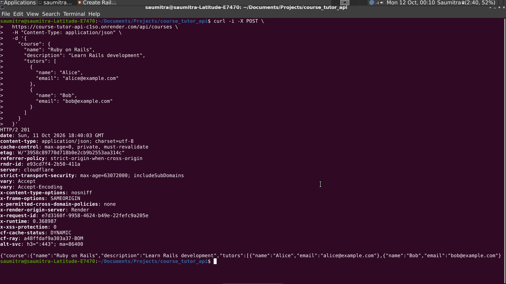
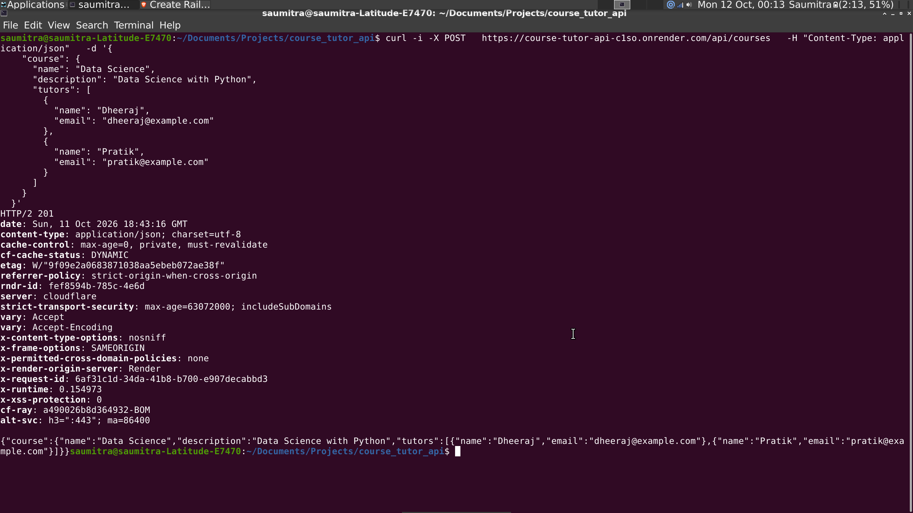
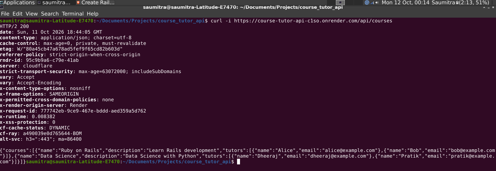
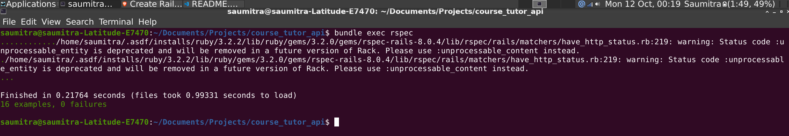

# Course Tutor API

A RESTful API built with Ruby on Rails and PostgreSQL for managing courses and their associated tutors.

**Live API:** https://course-tutor-api-c1so.onrender.com

Testing screenshots for the lie API and RSpec are added in the section 'Testing Evidence' of thi readme

## Overview

The Course Tutor API allows clients to create courses along with their tutors and retrieve courses with their associated tutor information.

The application is built using Rails in API-only mode, with PostgreSQL as the database. It includes model validations, association handling, transactional record creation, and automated tests.

## Tech Stack

* **Language:** Ruby 3.2.2
* **Framework:** Ruby on Rails 8.0.5.1 (API-only)
* **Database:** PostgreSQL
* **Testing:** RSpec
* **Deployment:** Render

## Features

* Create a course with multiple tutors in a single API request.
* Retrieve all courses along with their associated tutors.
* Validate required course and tutor attributes.
* Validate tutor email formats and enforce case-insensitive email uniqueness.
* Maintain the relationship between courses and tutors.
* Create a course and its tutors transactionally to prevent partial records if creation fails.
* Automatically delete associated tutors when their course is deleted.

## Data Model

### Course

| Attribute     | Description              |
| ------------- | ------------------------ |
| `id`          | Unique course identifier |
| `name`        | Course name              |
| `description` | Course description       |

A course has many tutors.

### Tutor

| Attribute   | Description                 |
| ----------- | --------------------------- |
| `id`        | Unique tutor identifier     |
| `name`      | Tutor name                  |
| `email`     | Tutor email address         |
| `course_id` | ID of the associated course |

A tutor belongs to one course.

## Getting Started

### Prerequisites

Ensure you have the following installed:

* Ruby 3.2.2
* Bundler
* PostgreSQL
* Git

### 1. Clone the repository

```bash
git clone https://github.com/Saumitra-02/course_tutor_api.git
cd course_tutor_api
```

### 2. Install dependencies

```bash
bundle install
```

### 3. Configure PostgreSQL

Ensure PostgreSQL is installed and running locally.

The development database is configured as `course_tutor_api_development` in `config/database.yml`.

If your local PostgreSQL installation requires a username or password, configure the appropriate connection settings for your environment.

### 4. Create and migrate the database

```bash
bin/rails db:prepare
```

This prepares the development database and applies the required migrations.

### 5. Start the Rails server

```bash
bin/rails server
```

The application will be available at:

http://localhost:3000

### 6. Run the test suite

Run the automated RSpec tests with:

```bash
bundle exec rspec
```

The test suite covers model validations, course–tutor associations, API endpoints, validation failures, and transactional behavior.

## API Documentation

**Base URL:** `https://course-tutor-api-c1so.onrender.com`

For local development, replace the base URL with `http://localhost:3000`.

### 1. Create a course with tutors

* **Method:** `POST`
* **Endpoint:** `/api/courses`
* **Content-Type:** `application/json`

#### Request body

```json
{
  "course": {
    "name": "Ruby on Rails",
    "description": "Learn Rails development",
    "tutors": [
      {
        "name": "Alice",
        "email": "alice@example.com"
      },
      {
        "name": "Bob",
        "email": "bob@example.com"
      }
    ]
  }
}
```

#### Example using cURL

```bash
curl -i -X POST \
  https://course-tutor-api-c1so.onrender.com/api/courses \
  -H "Content-Type: application/json" \
  -d '{
    "course": {
      "name": "Ruby on Rails",
      "description": "Learn Rails development",
      "tutors": [
        {
          "name": "Alice",
          "email": "alice@example.com"
        },
        {
          "name": "Bob",
          "email": "bob@example.com"
        }
      ]
    }
  }'
```

The endpoint creates the course and its associated tutors and returns the API response.

### 2. Retrieve all courses

* **Method:** `GET`
* **Endpoint:** `/api/courses`

#### Example using cURL

```bash
curl -i \
  https://course-tutor-api-c1so.onrender.com/api/courses
```

#### Example response

```json
{
  "courses": [
    {
      "id": 1,
      "name": "Ruby on Rails",
      "description": "Learn Rails development",
      "tutors": [
        {
          "id": 1,
          "name": "Alice",
          "email": "alice@example.com"
        },
        {
          "id": 2,
          "name": "Bob",
          "email": "bob@example.com"
        }
      ]
    }
  ]
}
```

The IDs shown are illustrative. Actual IDs and records depend on the database contents.

### Validation and Error Handling

The application validates course and tutor data before persisting records. Tutor email addresses must have a valid format and must be unique regardless of letter casing.

Invalid requests return validation errors with an HTTP `422 Unprocessable Entity` response. Transactional creation ensures that a failed nested creation does not leave behind a partially created course and tutor collection.

## Testing Evidence

Screenshots demonstrating the deployed API and automated test results are included below.

### 1. Create a course with tutors — POST `/api/courses`





### 2. Retrieve courses — GET `/api/courses`



### 3. Automated RSpec test results



## Deployment

The application is deployed on Render.

* **Production URL:** https://course-tutor-api-c1so.onrender.com
* **Courses endpoint:** [GET /api/courses](https://course-tutor-api-c1so.onrender.com/api/courses)

The production environment uses a PostgreSQL database configured through the `DATABASE_URL` environment variable. The Rails master key is configured through Render environment variables rather than committed to the repository.